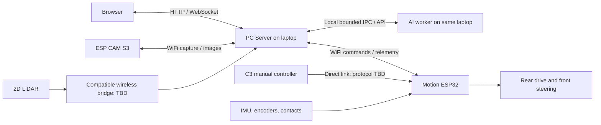

# Current architecture

Status: user-confirmed direction on 14 October 2026; implementation remains planned.
See [accepted ADRs](decisions/README.md) and [open implementation decisions](../project/open-decisions.md).

| Component | Responsibilities |
| --- | --- |
| One laptop beside the arena | PC Server, radio adapters, browser APIs, authority coordination, telemetry validation, localization, initial 2D mapping, navigation and persistent image/events |
| AI worker on that same laptop | Bounded asynchronous advisory image analysis; intended Cloudflare Clef-Flash Q8_0 runtime still needs verification |
| Rover motion ESP32 | Two rear encoder motors, front-wheel steering, IMU, front/rear contacts, local feedback/stops, command freshness and final command authority across laptop and C3 |
| Separate ESP CAM S3 | WiFi image capture and transfer to laptop |
| One 2D LiDAR | Planar scan acquisition; USB on bench, compatible wireless acquisition bridge during untethered driving |
| C3 manual controller | Manual-driving intent directly to motion ESP32; exact board, controls and radio protocol unresolved |
| Phone / browser | Laptop-hosted interface for mode, map/path, status, capture/events and manual intent |

The PC Server is software on the laptop, not another physical computer.
Server and AI share a host but run through a bounded local interface; inference cannot
block control or issue motor commands. There is no Raspberry Pi or separate home inference host.

USB/UART between ESP and laptop and direct LiDAR USB are tethered bench paths only.
See [transport boundaries](transport.md). A separate Internet exchange still needs to
be selected and demonstrated for school IoT compliance.

The server arbitrates browser/autonomy intent; because C3 bypasses it, the motion ESP32
must enforce one active authority at the final actuator boundary and report ownership.
No fallback, reboot or reconnection may silently resume movement.

Localization and path planning must use calibrated front-steering geometry, wheelbase,
steering angle/quality and encoder/IMU input. Differential-drive yaw equations and
turn-in-place actions are not valid defaults for this chassis.

The user removed the separate ToF sensor and rotation mechanism on 14 October 2026;
see [ADR 0005](decisions/0005-lidar-only-distance-sensing.md). The 2D LiDAR is the
planned distance/obstacle sensor. Coverage, scan freshness, mount geometry and stopping
limits still require measurement; the design choice does not establish drop detection or 3D mapping.

When the user refers to **תרשים מלבנים**, they mean the
[editable tldraw board](https://www.tldraw.com/f/4aOaHZDyKxk2AseGkkgxy?d=v-358.-186.2651.1825.page).
That board still needs alignment; exported assets are historical until reverified.
